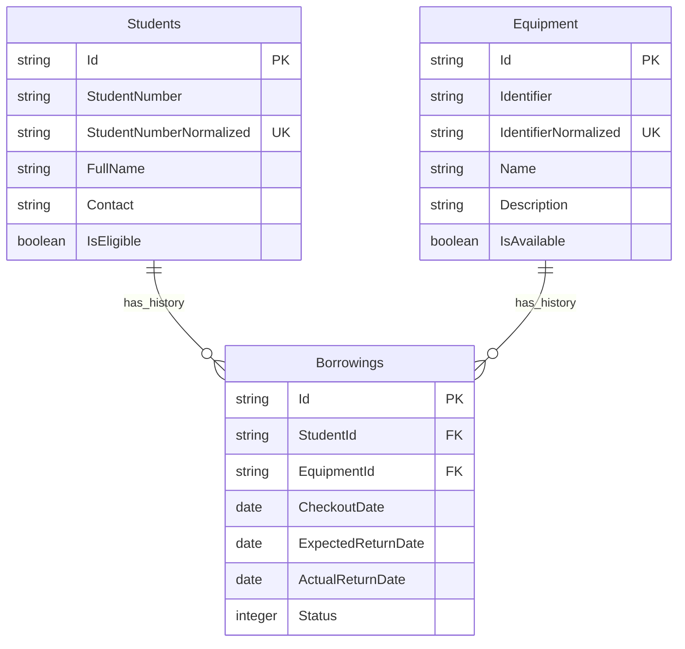

# SQLite schema

The active schema is created by the EF Core migrations in
`EquipmentBorrowing/src/EquipmentBorrowing.Infrastructure/Persistence/Migrations/`.
The migration sequence is:

1. `20261004084854_InitialCreate`
2. `20261121022649_AlignActivity4Schema`

## Database integrity rules

- `Students.Id`, `Equipment.Id`, and `Borrowings.Id` are primary keys.
- New PostgreSQL API records use readable IDs: students use `ST-` plus a
  sequence, equipment uses its identifier (such as `EQ-102`), and borrowings
  use `BR-` plus a sequence. Existing IDs are left intact.
- `StudentNumberNormalized` and `IdentifierNormalized` each have unique
  indexes; the repositories trim and uppercase identifiers before storing
  them.
- `Borrowings.StudentId` and `Borrowings.EquipmentId` reference their parent
  rows with restrictive delete behavior, preserving history.
- `CK_Borrowings_ExpectedReturnDate` requires the expected date to be after
  checkout. `CK_Borrowings_Status` limits status values to the defined enum
  range.
- `IX_Borrowings_EquipmentId_Active` is a unique partial index on
  `Borrowings.EquipmentId` where `Status = 0` (`Active`); one item cannot have
  multiple active loans. `IX_Borrowings_StudentId` supports student history
  queries.
- Required fields and normalized duplicates are validated by the repositories.
  The maximum of three active loans per student is checked inside the
  serializable checkout transaction; it is not a database check constraint.
- There is no hard-delete workflow for students, equipment, or borrowing
  history.

`MigrationTests.Upgrade_PreservesLegacyRecordsAndMapsCurrentSchema` upgrades
an in-memory SQLite database and exercises the unique indexes, foreign keys,
and borrowing check constraints.
