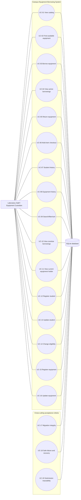

# Laboratory Activity 4 — use cases and traceability

The primary actor is **Laboratory Staff / Equipment Custodian**. Students are
stakeholders whose records, eligibility, and borrowing history must remain
accurate. The retained application uses SQLite as its system of record.

## Use-case diagram

## Catalog

| ID | Use case | Lab 4 classification |
|---|---|---|
| UC-01 | View Equipment Catalog | Required continuation |
| UC-02 | Find Available Equipment | Required continuation |
| UC-03 | Borrow Equipment | Required continuation |
| UC-04 | View Active Borrowings | Required continuation |
| UC-05 | Return Equipment | Required continuation |
| UC-06 | Check Out Multiple Equipment Items | Required new |
| UC-07 | View Student Borrowing History | Required new |
| UC-08 | View Equipment Borrowing History | Required new |
| UC-09 | Search, Filter, and Sort Borrowings | Required new |
| UC-10–11 | View Overdue Borrowings; View Current Equipment Holder | Deferred to Laboratory Activity 5 |
| UC-12 | Register Student | Required new |
| UC-13 | Update Student Information | Required new |
| UC-14 | Change Student Borrowing Eligibility | Required new |
| UC-15 | Register Equipment | Required new |
| UC-16 | Update Equipment Information | Required new |
| UC-17 | Migration and database integrity | Cross-cutting verification |
| UC-18 | Safe failure and recovery | Cross-cutting verification |
| UC-19 | Submission traceability | Submission verification |
| UC-20–27 | Equipment retirement/maintenance, return condition, renewals, multi-return, due-soon/count/utilization/category, and void history | Deferred to Laboratory Activity 5 |
| UC-28–33 | Reservations, staff audit/accounts, exports, and external services/notifications | Future scope |

## Shared use-case fields

- **Scope / level:** the relevant equipment catalog, borrowing, query, student
  management, or equipment management; each is an actor-level user goal.
- **Stakeholders:** the custodian needs an accurate, understandable workflow;
  students need correct records and preserved history.
- **Failure guarantee:** rejected or known-failed operations preserve existing
  data. An unknown commit outcome is reported according to BR-18; it is not
  represented as a successful write or an asserted rollback.
- **Special requirements:** SQLite persistence, clear feedback, and
  separation of View, ViewModel, application service, repository, and
  infrastructure responsibilities. History/search loads are asynchronous.
- **Includes / extends:** none required. Internal validation is not a separate
  use case. **Open issues:** none.

## Required use-case suite

### UC-01 — View Equipment Catalog

- **Trigger / preconditions:** staff opens the catalog; the application is
  running.
- **Success guarantee / main flow:** no records change. The system retrieves
  current equipment identifiers, names, descriptions, and availability from
  SQLite and displays them.
- **Alternatives / exceptions:** an empty catalog has an explicit empty state;
  a database failure has an error state and retry.
- **Rules / acceptance:** BR-05–07, BR-10, BR-18–19. The displayed catalog
  matches the database, and empty and database-error states are distinguishable.
  **Evidence:** A01.

### UC-02 — Find Available Equipment

- **Trigger / preconditions:** staff requests available equipment; the
  application is running.
- **Success guarantee / main flow:** no records change. The system reads current
  availability and displays only available items.
- **Alternatives / exceptions:** no available items is an empty result; a
  database failure allows retry.
- **Rules / acceptance:** BR-10, BR-18–19. Unavailable items are excluded and
  no-match/error states differ. **Evidence:** A02.

### UC-03 — Borrow Equipment

- **Trigger / preconditions:** staff submits a single-item borrowing and can
  select a student and item.
- **Success guarantee / main flow:** staff selects a student, item, and
  expected return date; the system revalidates references, eligibility, active
  limit, date, and availability, then persists one active borrowing and the
  unavailable state together and refreshes the UI.
- **Alternatives / exceptions:** missing, ineligible, over-limit, unavailable,
  or invalid-date requests are rejected without changes. Stale/conflicting
  records refresh; database failure is reported as failed or unknown, as
  appropriate.
- **Rules / acceptance:** BR-08–11, BR-14–16, BR-18–19. Success creates one
  active row and rejected attempts create none; the result survives restart.
  **Evidence:** A03.

### UC-04 — View Active Borrowings

- **Trigger / preconditions:** staff opens the active borrowing list; the
  application is running.
- **Success guarantee / main flow:** no records change. The system retrieves
  active records and related student/equipment data, then displays identities
  and relevant dates.
- **Alternatives / exceptions:** no active records is an empty state; a
  database failure is reported with retry.
- **Rules / acceptance:** BR-14, BR-18–19. Returned records are excluded and
  empty/error states differ. **Evidence:** A04.

### UC-05 — Return Equipment

- **Trigger / preconditions:** staff submits a return for a selected active
  borrowing.
- **Success guarantee / main flow:** the system rechecks current status and
  atomically marks the same borrowing returned, records the local return date,
  makes its item available, confirms, and refreshes.
- **Alternatives / exceptions:** a repeat return is rejected without change;
  missing/stale records refresh; a database failure or unknown commit is
  reported without asserting success.
- **Rules / acceptance:** BR-10, BR-13–16, BR-18–19. The record remains in
  history, the item is available, and repeat return does not change it.
  **Evidence:** A05.

### UC-06 — Check Out Multiple Equipment Items

- **Trigger / preconditions:** staff submits a multi-item checkout; the student
  and equipment can be selected.
- **Success guarantee / main flow:** staff selects one student, at least two
  distinct items, and one expected return date. The system revalidates current
  references, eligibility, active count, availability, and date, then commits
  all borrowing rows and availability changes in one transaction.
- **Alternatives / exceptions:** fewer than two items, duplicates, invalid
  date, ineligible/missing student, active-limit violation, or unavailable/
  missing item is rejected without writes. Stale/conflicting state refreshes;
  a known in-transaction failure rolls back; an uncertain commit follows
  BR-18.
- **Rules / acceptance:** BR-08–12, BR-14–16, BR-18–19. Two valid items create
  two active rows; each invalid attempt and controlled failure creates no
  partial checkout. **Evidence:** A06.

### UC-07 — View Student Borrowing History

- **Trigger / preconditions:** staff selects a student and opens the history.
- **Success guarantee / main flow:** asynchronously retrieve only that
  student's active and returned borrowings with related equipment, dates, and
  status; show actual return date when present.
- **Alternatives / exceptions:** no history is an empty state; selecting
  another student replaces the results; missing/stale student or database
  failure is explained and allows reselection/retry.
- **Rules / acceptance:** BR-14, BR-18–19. Different students' records do not
  mix, and active/returned/empty/error results are accurate.
  **Evidence:** A07.

### UC-08 — View Equipment Borrowing History

- **Trigger / preconditions:** staff selects equipment and opens its history.
- **Success guarantee / main flow:** asynchronously retrieve only that item's
  active and returned borrowings with related students, dates, and status; show
  actual return date when present.
- **Alternatives / exceptions:** no history is an empty state; selecting
  another item replaces the results; missing/stale equipment or database
  failure is explained and allows reselection/retry.
- **Rules / acceptance:** BR-14, BR-18–19. Different items' records do not
  mix, and active/returned/empty/error results are accurate.
  **Evidence:** A08.

### UC-09 — Search, Filter, and Sort Borrowings

- **Trigger / preconditions:** staff opens borrowings or enters query criteria.
- **Success guarantee / main flow:** asynchronously retrieve and display
  related borrowing records matching partial, case-insensitive text in student
  name/number or equipment name; optional status All/Active/Returned; and
  checkout-date or expected-return-date sort in either direction. Criteria may
  be combined and cleared.
- **Alternatives / exceptions:** no matches is an explicit empty result; a
  database failure has an error and retry.
- **Rules / acceptance:** BR-17–19. Search each field, each status, both sort
  fields/directions, combined criteria, reset, no-match, and error states.
  **Evidence:** A09.

### UC-12 — Register Student

- **Trigger / preconditions:** staff submits a student using the registration
  form.
- **Success guarantee / main flow:** staff enters institutional number,
  full name, and optional contact; the system validates and persists one
  unique, eligible student, confirms, and displays it.
- **Alternatives / exceptions:** blank required fields and normalized duplicate
  numbers are rejected; omitted/blank optional contact is absent. Concurrent
  duplicates/database failures are reported without creating a duplicate.
- **Rules / acceptance:** BR-01–02, BR-16, BR-18–19. The record is retrievable
  after restart. **Evidence:** A12.

### UC-13 — Update Student Information

- **Trigger / preconditions:** staff finds/selects an existing student and
  submits permitted edits.
- **Success guarantee / main flow:** validate and persist the same student's
  number, full name, and optional contact; display the updated record while
  retaining identity and borrowing links.
- **Alternatives / exceptions:** blank optional contact clears it; blank
  required fields or a duplicate number are rejected without change; stale
  record/conflict/database failure is explained and allows refresh/retry.
- **Rules / acceptance:** BR-01–03, BR-14, BR-16, BR-18–19. Edits persist after
  restart without changing linked history. **Evidence:** A13.

### UC-14 — Change Student Borrowing Eligibility

- **Trigger / preconditions:** staff selects an existing student and chooses
  permit or restrict.
- **Success guarantee / main flow:** persist and confirm the requested
  eligibility while leaving existing active borrowings/history unchanged.
- **Alternatives / exceptions:** repeating the current state informs staff
  without an unintended change; restricted students can still return existing
  loans; missing/stale student or database failure is reported.
- **Rules / acceptance:** BR-04, BR-08, BR-13–14, BR-18–19. Restriction blocks
  new borrowing but does not cancel active loans; permitting allows a valid
  subsequent checkout. **Evidence:** A14.

### UC-15 — Register Equipment

- **Trigger / preconditions:** staff submits a new physical item.
- **Success guarantee / main flow:** validate identifier, name, optional
  description; persist one unique item as available with no active borrowing;
  confirm and display it.
- **Alternatives / exceptions:** blank required fields or normalized duplicate
  identifier are rejected; blank optional description is absent; concurrent
  duplicate/database failure creates no duplicate.
- **Rules / acceptance:** BR-05–06, BR-10, BR-16, BR-18–19. A valid item is
  available after restart. **Evidence:** A15.

### UC-16 — Update Equipment Information

- **Trigger / preconditions:** staff finds/selects existing equipment and
  submits descriptive edits.
- **Success guarantee / main flow:** validate and persist identifier, name, or
  description for the same item while retaining availability and history.
- **Alternatives / exceptions:** blank optional description clears it; blank
  required values or duplicate identifier are rejected; availability/borrowing
  fields are not editable as descriptive data; missing/stale item or database
  failure is explained with refresh/retry.
- **Rules / acceptance:** BR-05–07, BR-10, BR-14, BR-16, BR-18–19. Edits persist
  after restart without changing history or availability.
  **Evidence:** A16.

## Cross-cutting acceptance criteria

UC-17–UC-19 are submission and reliability criteria, not additional
user-facing checkout functions.

### UC-17 — Migration and database integrity

The SQLite migrations create or upgrade the `Students`, `Equipment`, and
`Borrowings` schema, preserve legacy records, and enforce the documented keys,
foreign keys, check constraints, unique normalized identifiers, and partial
active-loan index. **Evidence:** A17.

### UC-18 — Safe failure and recovery

Rejected operations provide clear feedback and write no partial state. After a
database failure is corrected, retry can succeed; an uncertain commit result
must not be reported as a confirmed success or rollback. **Evidence:** A18.

### UC-19 — Submission traceability

The README, ERD, use-case catalog, evidence matrix, automated suite, source,
migrations, and Git history describe the same retained SQLite project.
**Evidence:** A19.

## Traceability matrix

| Use case | Application behavior | Verification/evidence |
|---|---|---|
| UC-01 | Equipment catalog and availability columns | A01: compare with SQLite; empty and connection-error states |
| UC-02 | Available-only catalog filter | A02: unavailable items excluded; no-match and load-error states |
| UC-03 | Equipment single checkout command and transactional repository | A03: valid issue, each rejection, fresh DB read, restart |
| UC-04 | Active filter in borrowing list | A04: related identities, empty/error, returned excluded |
| UC-05 | Return command and atomic repository update | A05: returned status/date, available item, repeat/missing selection |
| UC-06 | Multi-item checkout view/service and one serializable transaction | A06: success, each rejection, controlled failure rollback |
| UC-07 | Student selection and async history query | A07: two students, empty/error, no cross-contamination |
| UC-08 | Equipment selection and async history query | A08: two items, empty/error, no cross-contamination |
| UC-09 | Search criteria repository query and borrowing filter/sort controls | A09: each field/status/sort direction, combination/reset/no-match/error |
| UC-10 | Overdue borrowing view | A10: deferred to Laboratory Activity 5 |
| UC-11 | Current equipment holder view | A11: deferred to Laboratory Activity 5 |
| UC-12 | Student register service/repository and form | A12: valid/default eligible, blanks/normalized duplicate, restart |
| UC-13 | Student descriptive update form/service/repository | A13: same ID and history preserved; blank/duplicate rejected |
| UC-14 | Eligibility permit/restrict commands | A14: new issue rejected while restricted, old return allowed, re-permit |
| UC-15 | Equipment register service/repository and form | A15: available after restart; blanks/normalized duplicate rejected |
| UC-16 | Descriptive equipment update form/service/repository | A16: stable ID/history/availability; blank/duplicate rejected |
| UC-17 | SQLite migrations and integrity constraints | A17: legacy upgrade and database constraints |
| UC-18 | Safe failure and retry behavior | A18: rollback/unknown outcome and recovery walkthrough |
| UC-19 | Submission artifact consistency | A19: verify docs, tests, source, migrations, and history |

The scenario setup, expected state, and observed-evidence checklist are in
[lab4-verification.md](lab4-verification.md). Include the development history
when submitting (for example, `git log --oneline`) rather than fabricating
commits or dates.
